# User guide

Commerce Studio-র প্রতিটি page একই নিয়মে চলে: **choose → generate → review → apply → (rollback)**। Generate করলে কিছুই save হয় না — সব suggestion "Waiting for review" অবস্থায় থাকে।

Left sidebar-এ প্রতিটি page-এর section list থাকে (ScrollSpy — scroll করলে বর্তমান section highlight হয়)। ☀/☾ button দিয়ে dark/light theme বদলান — পছন্দ প্রতি user আলাদা মনে থাকে।

## Dashboard

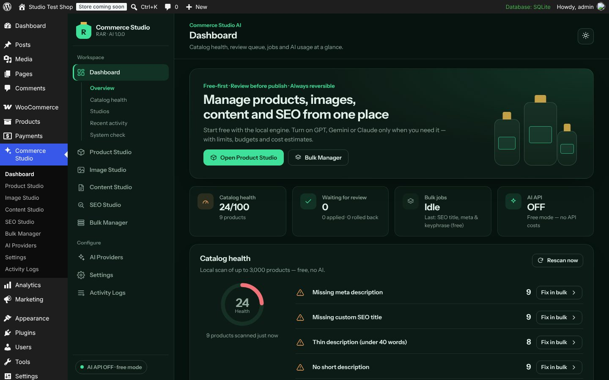

- **Catalog health** — up to 3,000 products scanned locally (free): missing meta, SEO title, short description, thin descriptions (< 40 words), missing image / alt text, duplicate and near-duplicate products. **Fix in bulk** opens Bulk Manager with that list.
- **Waiting for review** — pending suggestions across all studios.
- **System check** — PHP, memory, GD/WebP, HTTPS, WooCommerce, HPOS, SEO plugin, WP-Cron, encryption.

## Product Studio

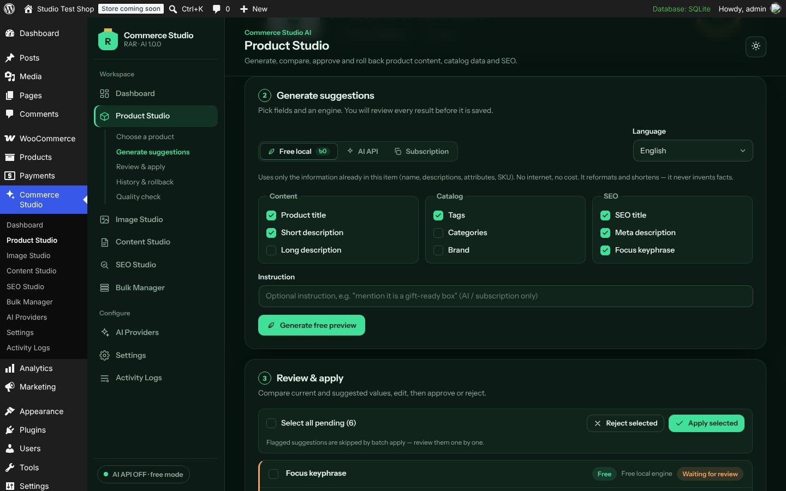

1. **Choose a product** — name, SKU বা ID দিয়ে search। Product edit screen-এর "Commerce Studio" box এবং Products list-এর **Studio** row link থেকেও খোলা যায়।
2. **Generate suggestions** — fields বাছুন (title, short/long description, tags, categories, brand, SEO title/meta/keyphrase), language (English / বাংলা / bilingual), engine:
   - **Free local** — শুধু আপনার product data থেকে formatting; কোনো নতুন fact যোগ করে না।
   - **AI API** — enabled হলে; run-এর আগে আনুমানিক খরচ দেখায়।
   - **Subscription** — prompt copy করে ChatGPT/Gemini/Claude app-এ চালান, উত্তর (JSON) paste করে **Import answer as suggestions**।
3. **Review & apply** — current vs suggested পাশাপাশি, word-level diff, HTML preview। Edit করে **Save edit**, তারপর **Approve & apply** বা **Reject**। Select করে batch apply/reject।
4. **History & rollback** — applied change-এর আগের value ফেরত।

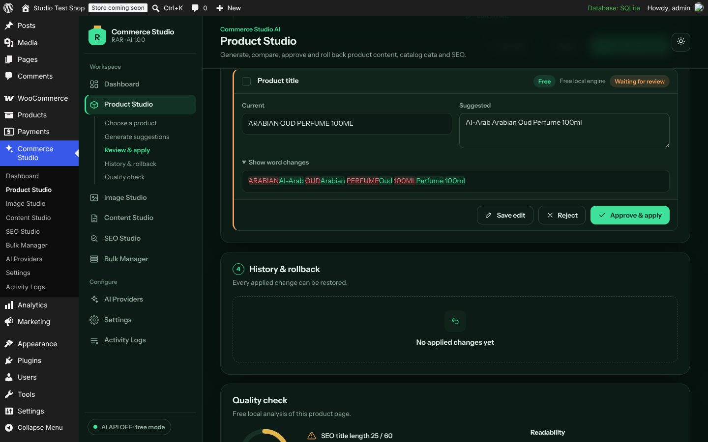

**Fact guard:** suggestion-এ আপনার data-তে নেই এমন সংখ্যা, size, certification, organic/halal claim, health claim, guarantee বা price/offer থাকলে লাল box দেখায়; **I verified these facts** tick না দিলে apply হয় না। Batch apply flagged suggestion skip করে।

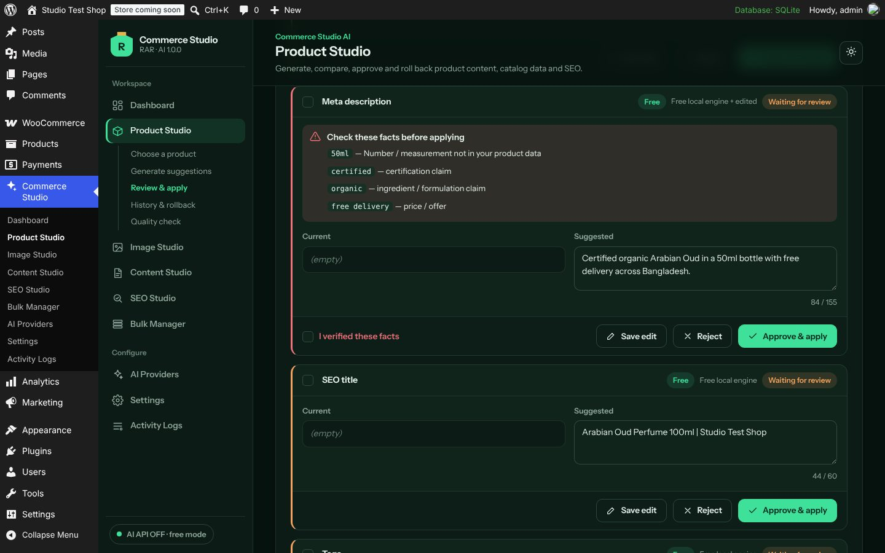

Categories ও brand শুধু **existing** terms থেকে বাছা হয় — নতুন term তৈরি হয় না। Price, stock, SKU, variations কখনো বদলায় না।

## Image Studio

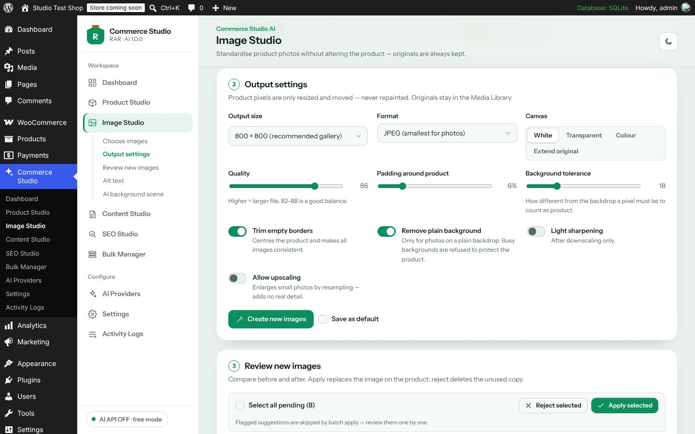

1. Product বাছুন (featured + gallery দেখাবে) বা Media Library-র যেকোনো ছবি।
2. **Output settings** — size (300, 600, 800, 1000, 1200, 1600 px বা custom 100–2400 px square), format JPEG/WebP/PNG, quality, padding, canvas (white, transparent, colour, original), trim borders, **Remove plain background** (শুধু সমান রঙের background; busy background হলে refuse করে), sharpen, upscale (default off)।
3. **Create new images** — নতুন file তৈরি হয় (original অক্ষত)। Before/after slider দিয়ে মিলিয়ে দেখুন। **Apply** product-এ নতুন ছবি বসায়; **Reject** অব্যবহৃত copy মুছে দেয়; **Roll back** আগের ছবি ফেরত আনে।
4. **Alt text** — free local বা AI vision।
5. **AI background scene** (optional, API) — AI শুধু background আঁকে; আসল product photo উপরে বসে।

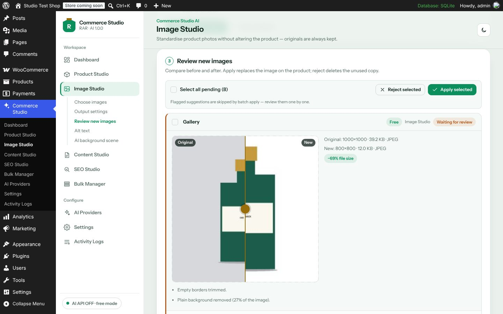

## Content Studio

Posts, pages ও media-র জন্য: excerpt, SEO fields, readability rewrite ও translation (AI/subscription), **Internal links** suggestions ও link drafts, **New article draft** (WordPress draft হিসেবে তৈরি, কখনো auto-publish নয়), **Media without alt text**। Elementor page শুধু analyse হয় — Elementor content rewrite করা হয় না।

## SEO Studio

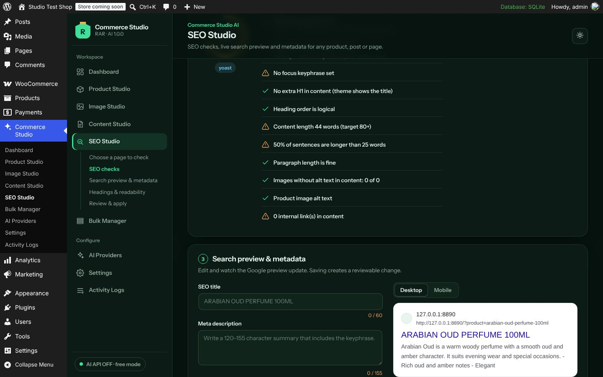

Keyphrase in title/meta/URL/first paragraph/headings, length, headings outline, readability, images & links। **Search preview** edit করলে Google-style preview সাথে সাথে বদলায়; save করলে reviewable change তৈরি হয় (Yoast / Rank Math / SEOPress fields)।

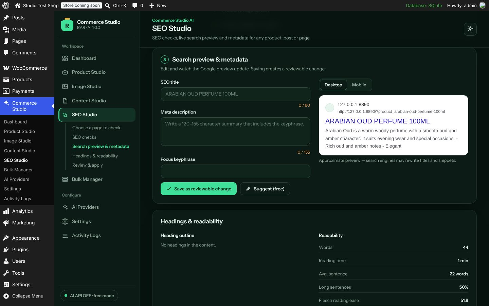

## Bulk Manager

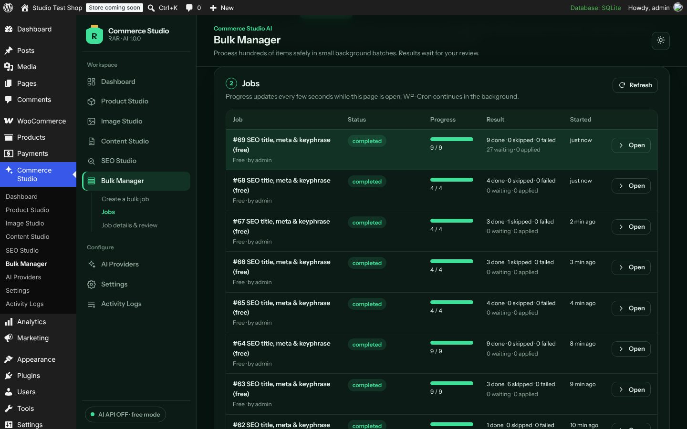

Operations:

| Operation | Cost |
| --- | --- |
| SEO title, meta & keyphrase (free) | Free |
| Product content formatting (free) | Free |
| Standardise product images (free) | Free |
| Image alt text (free) | Free |
| Posts/pages: excerpt & SEO (free) | Free |
| Product content & SEO with AI (API) | API |
| Image alt text with AI vision (API) | API |

Items বাছুন (selected IDs, search, category, brand, stock status, catalog-health issue), **Preview items** → **Start job**। Job ছোট batch-এ চলে (default 10 items, 15 s), page খোলা থাকলে দ্রুত, না থাকলে WP-Cron-এ। **Pause / Resume / Cancel / Retry failed**। Job শেষে **Apply all clean suggestions**, **Reject all pending**, **Roll back this job**, **CSV report**। AI limit বা budget শেষ হলে job নিজে থেকে pause হয়।

Products list → select → Bulk actions → **Optimise with Commerce Studio** দিয়েও job শুরু করা যায়।

## AI Providers

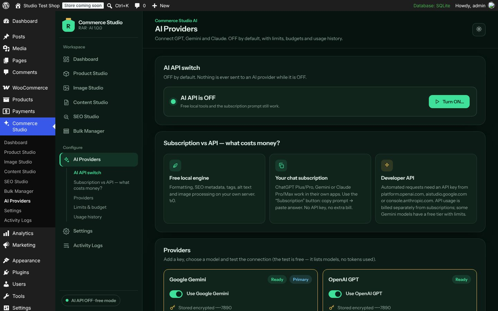
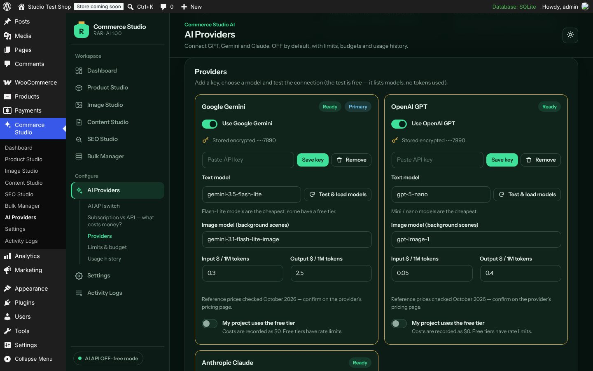

Master switch OFF থাকলে কোনো request বাইরে যায় না। Key add → **Test & load models** (free — শুধু model list) → provider enable → master switch ON (cost acknowledgement সহ)। Limits & budget, Usage history (tokens, estimated cost) দেখুন। বিস্তারিত: [AI-PROVIDERS.md](AI-PROVIDERS.md)।

## Settings

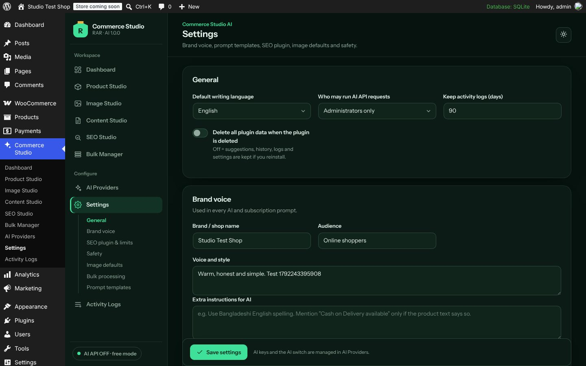

General (language, who may use AI, log retention, uninstall behaviour), **Brand voice** (name, voice, audience, banned words — সব prompt-এ যায়), SEO plugin & length limits, Safety (strict fact guard), Image defaults, Bulk processing (batch size, time budget — shared hosting-এ কম রাখুন), Prompt templates (advanced)।

## Activity Logs

কে, কখন, কী বদলেছে — level ও search filter, CSV export। API key বা secret কখনো log হয় না।

## Plugin row & phone

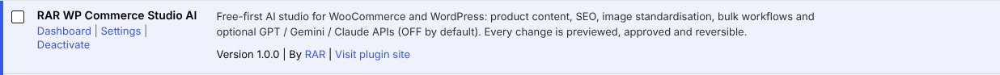

| Phone | Navigation |
| --- | --- |
| 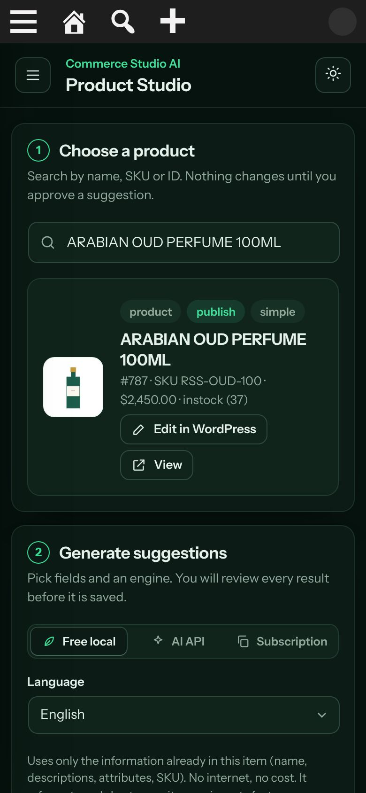 | 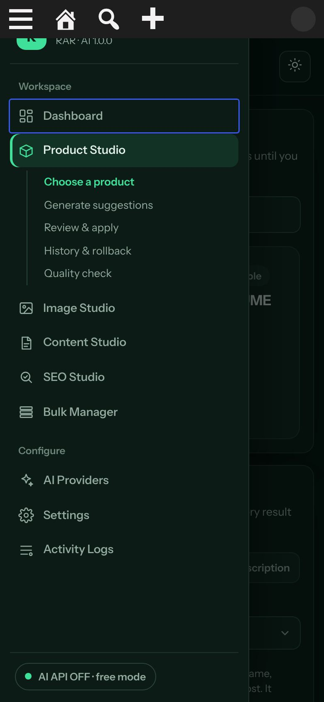 |
